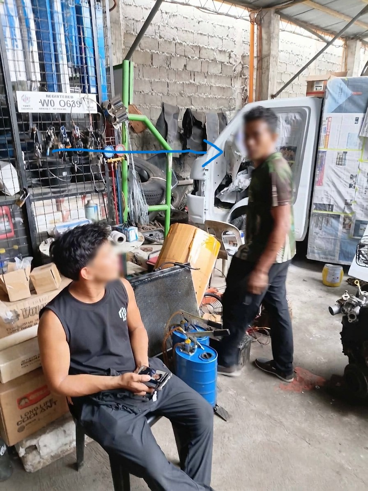
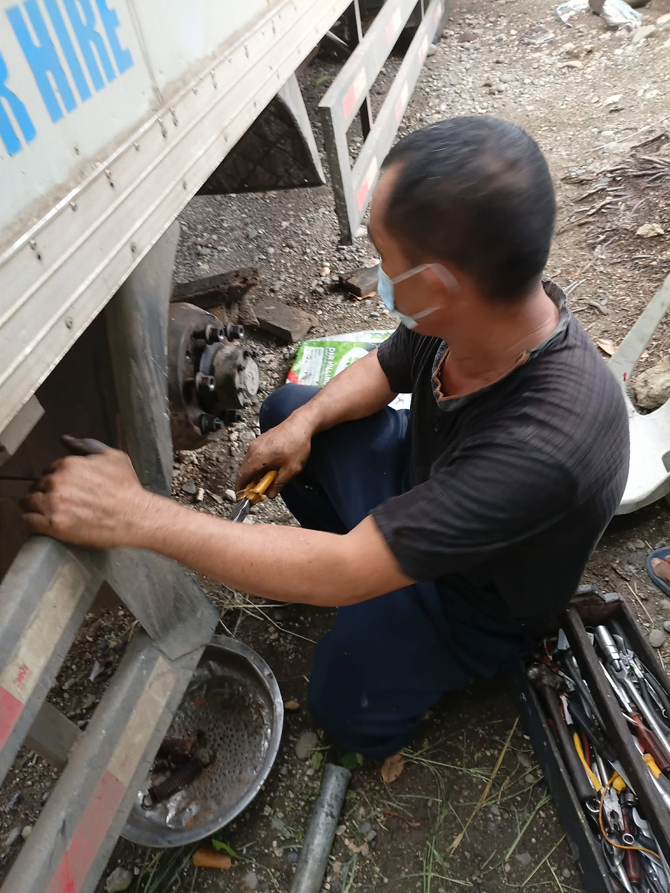

## 1st Interview
- **Shop:** Danny's Auto Repair Shop
- **Interviewee:** mechanic
 
- **Interviewer:** Charlson Dale Fabrigar
- **Date and method:** October 24, 2026, Interview

### How the shop prioritizes work
- Some maintenance can be delayed, such as an oil change.
- Some maintenance is higher priority, such as changing pads.
- Income-generating vehicles are fixed first. Personal cars come second.

### How cars are assigned to mechanics
- Some mechanics are assigned a regular customer's car.
- Reasons: they worked on it before, and they know the car's failure pattern well enough to have specialized knowledge.

### Customer complaints
- Switching: a customer's car goes off schedule because a utility vehicle is fixed first.
- Repairs take longer than expected because more parts turn out to be broken. [The shop informs the customer by phone.]
- Backjobs: repairs that don't go as planned.

### Failure modes
- **Emergency cases:** some cars fail on the road and need immediate attention. The interviewee said 4-12 hours are lost handling emergencies like this.
- **Absent workers:** assigned work has to be rescheduled.

## What Ideas or realization we get from this interview
- **Assigned and backup mechanics** Add fields for who usually works on the car and who else has worked on it, so a fallback exists when someone is absent.
- **Failure-pattern notes** A structured note for what the car does, what was found, and which parts failed together. That is what the shop says its mechanics keep in their heads.
- **Deferred-work list** Record what was postponed (for example, an oil change) so the next mechanic knows.

## 2nd Intervi- 
- **Shop:** Sanny's Auto Repair Shop. 
- **Interviewee:** mechanic.

- **Interviewer:** Charlson Dale Fabrigar
- **Date and method:** October 24, 2026

**1. What kind of vehicles are you most experienced at fixing?**
Medium-duty trucks for deliveries, and diesel passenger vehicles such as pickup trucks and SUVs.

**2. Who are your regular customers usually?**
Small businesses, especially those with a truck for hauling goods like hardware and livestock.

**3. Do you notice some parts usually fail together?**
Mostly the body, because many of the trucks I have worked on are old and exposed to the elements. They are "rain and shine" when it comes to operation.

**4. Do you take notes of regular customers' vehicles?**
Yes, but primarily in my mind. I memorize models and I remember what I have worked on previously for regular customers.

## What Ideas or realization we get from this interview
- **Quick note entry** A few fast fields after a job, so the mechanic can put what he remembers into the record without much extra work.
